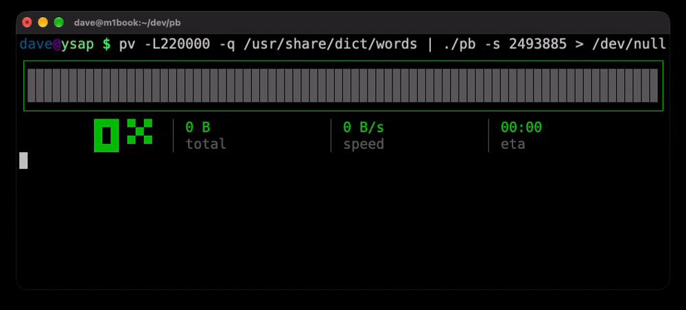

`pb` - Progress Bar
===================

A progress bar and stream transfer tool inspired by `pv`.

Implements the `pv` 1.12.7 feature set on Linux, with the original large
terminal display and the compatibility differences documented below.



Usage
-----

```sh
make
./pb input.bin > output.bin
producer | ./pb -s 1.5G > output.bin
./pb -q -L 10M first.bin second.bin > combined.bin
./pb -nlb records.txt > copied.txt
producer | ./pb -U - > output.bin
./pb -P /tmp/copy.pid -L 1M input.bin > output.bin
./pb -R 12345 -L 10M
./pb -Q 12345 -nb
./pb -d 12345:3
./pb -M both -- gzip -9 < input.bin > output.gz
./pb -c -N copy -btrp input.bin > output.bin
./pb -C -F '%b %p %40L' records.txt > copied.txt
```

The current implementation targets Linux. Build with a C11 compiler, POSIX threads, and libm (`cc -std=c11 pb.c -o pb
-pthread -lm`). `make check` runs the Python 3 black-box tests; installed `pv`
is used for additional differential checks when available.

With no file arguments, `pb` reads stdin. `-` denotes stdin among file
arguments. Regular file sizes (or line counts with `-l`) are inferred when
possible; pipes work without an estimated size. Data goes to stdout and progress
goes to stderr. Nonterminal stderr is quiet unless `-f` or `-n` is selected.

The original large terminal display remains the default at widths of at least
80 columns. Display switches such as `-btrp`, or a custom `-F` format, select a
compact display. `--large` explicitly selects the large display. `-n` produces
newline-delimited numeric output. `./pb --help` lists available options.

Feature coverage
----------------

The reference is [upstream pv 1.12.7](https://www.ivarch.com/programs/pv.shtml)
and its [manual](https://ivarch.com/programs/quickref/pv.shtml). All short and
long options are implemented. This is feature compatibility; terminal artwork,
human-readable spacing, and the private remote-control protocol differ.

| Area | Features | Verification |
| --- | --- | --- |
| Inputs and outputs | Multiple files, stdin, named output, device capacities, inferred totals, suffixes and `@path` sizes | Transfers, aliases, growing files, repeated stdin, simulated block devices, stat/access/close failures |
| Transfer controls | Rate/buffer/pipe limits, stop/discard, sync/direct/sparse I/O, error recovery, store-and-forward | Rate timing, spool ordering, aligned direct I/O, sparse tails, adaptive skips and fault injection |
| Copy engine | `copy_file_range`, `splice`, intermediate pipes, read/write fallback, `-C` | Native syscalls, unsupported-kernel injection, partial/EINTR writes, buffered data surviving remote changes |
| Counters | Bytes, bits, SI units, lines and NUL records, numeric counts/percentages | Differential reference checks, combinations, counts beyond floating-point integer precision |
| Display and formats | All fields and aliases, styles, colours, widths, Unicode, previous lines, last-written data, ratios | Alias/colour tables, literal preservation, terminal-cell widths, large histories, numeric precision |
| Display modifiers | Wait/delay, gauge, interval/window, dimensions, name, statistics, cursor rows, extra displays, ConEmu | Real PTYs, resize/height transitions, shared rows, dead-owner recovery, titles, quiet statistics |
| Process modes | PID files, descriptor/process/name/list watches, remote settings, continuous queries, command input/output/both monitoring | Live modifier matrix, deep watch lists, long paths, descriptor reuse, query snapshots, interactive commands |
| Lifecycle | Signals, job control, foreground ownership, cleanup, error bitmasks, command reaping | Stalled pipes/sockets/FIFOs, stop/resume, early consumers, injected errors, child and PID-file cleanup |

Tests cover byte-for-byte transfers, inferred totals, line/NUL counting,
rate limits, stop-at-size, output alias protection, sparse files, spool ordering
and persistence, PID-file cleanup, stalled-pipe/FIFO termination, read-error
recovery, and injected partial/EINTR writes. Process-mode tests cover live rate, size,
buffer, and display updates; concurrent queries and final snapshots; descriptor
reuse and deleted-but-open files; process-name and nested-list selection; command
transformations, early consumers, ratios, startup/write failures, secondary PID
files, and child reaping. Display tests use a terminal model to check independent
cursor rows, command-monitor rows, and recovery after a killed owner. Formatting
checks cover widths, Unicode, colours, previous lines, process/window titles,
ConEmu cleanup, literal sequences, and unknown-size numeric output.

Kernel-I/O tests exercise native `copy_file_range`, `splice`, aligned direct I/O,
and pipe resizing on the current system. Injected unsupported-syscall cases
verify that fallback preserves data already consumed into an intermediate pipe.
Block-device metadata/ioctl simulations cover inferred capacities, output limits,
alias protection, watched capacities, and cache flushing without writing to a
physical device. Further checks cover multi-megabyte history, large remote
formats and query snapshots, fractional rate limits, growing files, socket
backpressure, repeated stdin, and directory-size accounting.

Timing tests exercise real job-control stops/resumes, first-byte waiting,
long initial stalls, sparse display updates, and a piecewise-linear rate model
with more than 10000 samples. Moving-window sampling runs independently of the
display interval, and the window determines retained sample history rather than
a fixed sample count. Changing the averaging window starts a fresh history for
that setting. Display time excludes job-control suspension; the rate limiter
continues accruing its wall-clock budget, matching the reference. Statistics use
stable online variance calculation. The suite compares selected behavior with
`pv` and exercises the remaining features through independent behavioral checks.

Remote control and queries use a private, same-user Unix socket under
`/tmp/pb-UID/`. They control other `pb` instances; the IPC protocol is not shared
with `pv`. Display options omitted from a remote update retain their current
values. Queries receive a final snapshot before the target closes its socket.
Query line/NUL mode and averaging window must match the target; a running query
reports an error if a remote update makes those settings incompatible. Control
messages and snapshots use chunked packets, so names, formats, and captured
history are not restricted to one socket packet. Widths, heights, and history
requests use checked native-size values instead of the former fixed caps.
Last-written history uses a dynamically sized ring buffer. Line-prefix history
grows to the requested fields and retains at least a transfer-buffer-sized
prefix for later queries. Queries can display the history the source retained;
changing a field cannot recover bytes that were not captured earlier.

`-c` coordinates terminal rows using an owner registry under `TMPDIR`, `TMP`, or
`/tmp`; dead owners are detected using both PID and process start time. `-x`
accepts window-title and process-title destinations with optional format strings.
`-9` and `%{progress-conemu}` emit terminal-tab progress and clear it on exit.
Use `-C` when a format needs actual `%A` or `%L` data: accelerated transfers show
placeholder dots/spaces because those bytes never enter a userspace buffer.

Watch mode reads Linux `/proc` metadata and never reads from the watched data
stream. `-d PID` follows newly opened regular files until the process exits;
`-d PID:FD` finishes when that descriptor closes or changes file or access mode.
`-d '=NAME'` matches process names using an extended regular expression, and
`-d @LISTFILE` reads additional watch specifications from a file.

Repeated stdin arguments consume stdin through EOF and count its size once;
this avoids the installed reference's closed-stdin error. Unterminated format
sequences are preserved literally without its accidental NUL output. A closed
downstream pipe finishes silently and successfully, as in the reference.

Command monitoring supports `in`, `out`, and `both` (also `0`, `1`, `2`). In
`both` mode, names, formats, and PID files may each be given twice for the input
and output monitors. The output monitor has its own PID and can be queried or
controlled remotely. As with the reference, a monitored command's
nonzero exit code alone does not become the monitor's exit code.


Verification
------------

```sh
make check
PV_BINARY=/path/to/pv-1.12.7/pv make check
clang -std=c11 -Wall -Wextra -Wpedantic -Werror \
  -fsanitize=address,undefined -g pb.c -o /tmp/pb-sanitize -pthread -lm
PB_BINARY=/tmp/pb-sanitize python3 -m unittest discover -s tests
```

The suite contains 158 tests. Both pv 1.12.0 and 1.12.7 have been used as
reference binaries. The sanitizer run skips allocation-size tracing because
ASan binds its own allocator; that fault-injection check runs in the normal
build. Allocation-failure handling is exercised in both builds. Device tests
simulate metadata and ioctl responses; physical block-device writes are not
part of the suite.


Development
-----------

Watch me build this live on YouTube:

<a href="https://youtu.be/rl8wxVnJcs8"></a>


License
-------

All code licensed under the MIT License.
